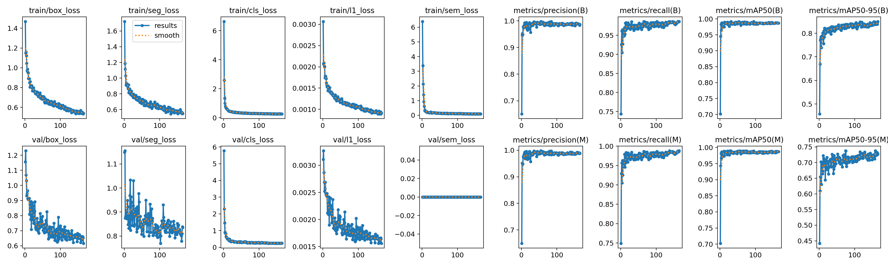

# G1 Cube Perception

Real-time RGB-D perception for **Unitree G1 EDU**: detect red/green ~5 cm cubes on a table, estimate 3D pose, and publish results over **ROS 2**.

`ROS 2 Humble · YOLO-seg · RealSense · Jetson TensorRT`

Built for the **X-Challenge** team stack (cube-sorting exercise). Core vision logic is ROS-free; `perception_node` is a thin rclpy wrapper.

## Demo

TODO: *Add `docs/media/demo/sorting_demo.gif` (5–10 s cube-sorting clip from competition footage).*

TODO: *Add `docs/media/demo/robot.jpg` (clean photo of the G1 / setup).*


## Highlights

- **YOLO segmentation** + geometric / PnP pose on aligned RealSense depth
- **Temporal voting** and **3D tracking**, with slot assignment along the start line
- **Exercise 1**: freeze start layout, stable `cube_N` names, re-ID after occlusion / push
- **Jetson deploy**: TensorRT `.engine` on GPU, ONNX CPU fallback
- Swappable segmenters (`hsv` / `yolo_seg`) and pose estimators (`centroid` / `geometric` / `pnp`)

## Results

Measured on the robot (Jetson Orin NX companion PC):

| Backend | Device | Latency |
|---------|--------|---------|
| TensorRT `.engine` | GPU | **30.9 ms / frame** |
| ONNX | CPU | **1494.3 ms / frame** |

Training curves / mAP (Ultralytics export from the training machine):

| Metric | Value |
|--------|-------|
| Segmentation mAP | TODO: *Paste mAP from Ultralytics on the training host* |
| Notes | TODO: *Optional short note on dataset / epochs* |

TODO: *Copy Ultralytics `results.png` to `docs/media/training/results.png`.*



## Architecture

```text
Frame (RGB + depth + K)
        │
        ▼
   Segmenter  →  list[Detection]     # hsv | yolo_seg
        │
        ▼
 PoseEstimator  →  Pose | None       # centroid | geometric | pnp
        │
        ▼
 Slot / track results                # red | green | empty | uncertain
```

Details: [docs/architecture.md](docs/architecture.md).

## Quick start

```bash
source /opt/ros/humble/setup.bash
colcon build --symlink-install --packages-up-to g1_perception
source install/setup.bash

# laptop (default params_laptop.yaml)
cd /ws && ros2 launch g1_perception perception.launch.py

# robot
ros2 launch g1_perception perception.launch.py config:=params_robot.yaml
```

Environment notes (NumPy &lt; 2, tests, `xchallenge_msgs`): [docs/environment.md](docs/environment.md).

## Repository layout

```text
├── src/g1_perception/     # ament_python package (core + ROS nodes)
├── tools/                 # record → frames → label → train → export → bench
├── docker/                # Humble image + pip constraints
├── deploy/                # robot requirements
├── docs/                  # engineering docs + media slots
└── models/                # inference weights (local / deploy)
```

Bags, extracted frames, datasets, and training runs stay **out of git** (`/bags/`, `data/`, `datasets/`, `runs/`). See [docs/environment.md](docs/environment.md#artifacts-not-in-git).

## Documentation

| Doc | Topic |
|-----|--------|
| [docs/architecture.md](docs/architecture.md) | Pipeline and Python modules |
| [docs/ros_nodes.md](docs/ros_nodes.md) | `perception_node`, exercise 1, AprilTag |
| [docs/config.md](docs/config.md) | Params and YAML |
| [docs/workflow.md](docs/workflow.md) | Offline data workflow |
| [docs/tools.md](docs/tools.md) | Tool CLI reference |
| [docs/robot.md](docs/robot.md) | Jetson / TensorRT deploy |
| [docs/training.md](docs/training.md) | Dataset → train → export |
| [docs/media/README.md](docs/media/README.md) | Demo clips and training plots |

## Context

Team project for **X-Challenge** on Unitree G1 EDU: perception feeds the cube-sorting controller with colors, poses, and stable cube identities over ROS 2 / TF.
